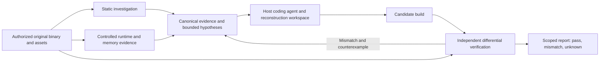

<div align="center">
  
  <h1>RE-Agent</h1>
  <p><strong>Reverse Engineering Agent for Legacy Software Maintenance</strong></p>
  <p>Investigate unsupported software. Recover documented behavior. Verify repairs and independent ports.</p>
</div>

RE-Agent is a **local-first, evidence-driven reverse-engineering toolkit** for maintainers of authorized legacy **desktop applications, command-line software, and games**. It connects coding agents to static analysis, controlled runtime observation, memory evidence, and bounded reconstruction/verification workflows through existing CLI and MCP interfaces.

**Status:** Active development. RE-Agent does **not** automatically recreate arbitrary applications or prove whole-program equivalence. Scope, platform support, execution permissions, and available observations determine what can be verified.

## What it is built for

| Workstream | Intended outcome | Evidence required |
| --- | --- | --- |
| **Legacy maintenance** | Reproduce a failure, identify dependencies and platform assumptions, repair an authorized implementation | Original binary identity, reproducer, before/after regression |
| **Native software analysis** | Investigate PE/ELF/Mach-O code paths and binary interfaces | Function inventory, call references, provider identity and limitations |
| **Runtime and memory investigation** | Correlate observed behavior with static hypotheses | Authorized process/trace identity, bounded capture, reproducible conditions |
| **Independent application porting** | Reimplement a declared behavior slice on a new platform | Matching original/replica scenarios and explicit unsupported behavior |
| **Game preservation engineering** | Examine script formats, asset pipelines, engine interactions and gameplay behavior | File-format evidence, state/input traces, asset and frame comparisons where applicable |
| **Verification** | Detect regressions and expose unknown behavior | Raw original/candidate observations, explicit comparison rules and coverage |

## Real-world investigation record

### Project I.G.I. 2 — GConv / QVM tooling (2003 Windows PE32)

This is the project's **primary documented legacy investigation**, not a completed legacy-game port.

| Component | Evidence and result | Remaining work |
| --- | --- | --- |
| Executable and DLL inventory | Hash-bound examination of `gconv.exe`, `gconvapi.dll` and `vqdll.dll`; function/import/export records | Link native exports and calls to verified runtime semantics |
| QVM format work | Header/strings and partial instruction-format recovery; independently implemented `qvmtool` | Full QVM execution, native registration and error/edge semantics |
| Behavioral comparison | Historical 120-script error-message comparison receipt | Reproducible replay corpus and fresh verification on supported worker |
| Porting / compatibility | Analysis and limited independent tooling | Full DLL ABI, codec compatibility, app/game port and release rights not verified |

**Evidence:** [GConv case study](benchmarks/native-windows-ports/gconv/README.md) · [static inventory](benchmarks/native-windows-ports/gconv/analysis/gconv-functions-radare2.json) · [rights-screened target catalog](docs/legacy-target-catalog.md)

**Do not infer:** a repaired original application, full IGI engine recreation, complete QVM execution, or unrestricted rights to original binaries/assets.

### Evidence gallery

Screenshots are shown only when their provenance and capture scope are documented. An identical screenshot alone does not prove input replay or state equivalence.

- [Retained native/game capture evidence and limitations](docs/verification/rea-engine/) — contains captured images and manifests; several images are fixture comparisons rather than legacy-port proofs.
- [Game behavior verification contract](docs/game-behavior-verification.md) — outlines state, input and frame requirements.
- [Complete experimental benchmark inventory](benchmarks/README.md) — contains development fixtures and partial reconstructions, clearly separated from actual legacy-maintenance case studies.

**No verified end-to-end legacy application port with a complete original-versus-replica screenshot series is currently documented.** That is an engineering gap, not something to cover with illustrative screenshots.

## Analysis and reconstruction architecture



**Existing foundations:** Ghidra/IDA/Hopper providers and other artifact workflows; Frida/LLDB/process observations; authenticated Evidence records; persistent investigation checkpoints; bounded build/test/repair loops; selected conditional Z3 expression proofs.

**Important limits:** Semantic heap recovery, generalized algorithm reconstruction, broad differential fuzzing, universal binary equivalence, and complete native Windows/GUI-worker acceptance are not established. Tools discovered on disk are not necessarily installed, integrated, or verified for a target.

Read [architecture and autonomous reconstruction](docs/autonomous-reconstruction.md), [runtime observation](docs/frida-instrumentation.md), [verification scope](docs/autonomous-reconstruction-benchmark.md), and [open engineering issues](https://github.com/heaven-hm/re-agent/issues).

## Maintenance workflow

1. **Authorize and bind the target.** Record original hashes, rights and support status. Preserve originals.
2. **Reproduce the defect or behavior.** Capture inputs, dependencies, environment and failures.
3. **Correlate static and runtime evidence.** Separate observed facts from inferred hypotheses.
4. **Repair or port in a separate workspace.** Do not modify the original binary by default.
5. **Compare independently.** Preserve mismatches as regression inputs.
6. **Report scope and limitations.** A passing finite suite proves only its declared observations.

The nine documented maintenance modules cover provenance, triage, static diagnosis, runtime/memory observation, repair, porting, verification and release review. For the current branch's *actual installed* catalog, run:

```bash
node scripts/rea.mjs maintenance-skills
```

The module additions are tracked separately in [PR #23](https://github.com/heaven-hm/re-agent/pull/23); the catalog on `develop` may contain fewer modules until those changes merge. Community skill discovery reads metadata and instructions; it does not execute discovered code.

See [maintenance workflow](docs/legacy-maintenance.md) and [community skill format](docs/community-skills.md).

## Build and connect a coding agent

Requires a supported Node.js release and appropriate external analyzers for the target.

```bash
git clone https://github.com/heaven-hm/re-agent.git
cd re-agent
npm ci
npm run build:cached
node scripts/rea.mjs --help
node scripts/print-mcp-config.mjs /absolute/path/to/target --local
```

Use the generated MCP configuration with a supported host. Consult [installation](docs/installation.md), [CLI](docs/cli.md), and [MCP contracts](docs/mcp-contracts.md). The npm identity is `re-agent`; legacy command names exist for compatibility. Do not assume an upstream `rea` release contains fork-specific code.

## Validation and development fixtures

The repository retains arithmetic, UI, managed-program, and small open-source application/game benchmarks because they test specific components and regressions. **They are not showcased as professional legacy-support deliverables.** Their scoped results, unverified cases, capture files, and test commands remain in [benchmarks](benchmarks/README.md) and [validation reports](docs/re-agent-maintenance-validation.md).

A serious preservation case study should provide: independently identified original artifact; rights and environment; real reproducer; static/runtime evidence; candidate implementation and build instructions; replayable original/candidate comparisons; failure samples; platform matrix; and visual evidence where relevant. Until these exist, mark the target **PARTIAL** or **UNVERIFIED**.

## Project map

| Location | Purpose |
| --- | --- |
| `src/` | Providers, runtime capture, Evidence, maintenance and autonomy implementations |
| `maintenance-skills/` | Modular, bounded agent workflows |
| `bridge/` | Native/tool-specific bridges |
| `scripts/` | CLI entrypoints, build and verification scripts |
| `tests/` | Automated regression and contract testing |
| `benchmarks/` | Engineering fixtures, source-hidden experiments, case-study artifacts |
| `docs/` | Architecture, provider contracts, investigations and platform guides |

## Documentation and governance

[Legacy maintenance](docs/legacy-maintenance.md) · [Native investigation](docs/native-investigation.md) · [Ghidra provider](docs/ghidra-provider.md) · [Agent workflow](docs/autonomous-reconstruction.md) · [Evidence and MCP](docs/mcp-contracts.md) · [Testing](docs/testing.md) · [Roadmap](docs/roadmap.md)

Use RE-Agent only for authorized analysis, maintenance, preservation and independent porting. Software, assets, and optional tools keep their respective licenses. See [usage policy](USAGE_POLICY.md), [license](LICENSE) and [third-party notices](THIRD_PARTY_NOTICES.md).

**Contribution standard:** reproducible original/candidate evidence and truthful limits are more important than screenshots, target counts, or claimed reconstruction percentages.
