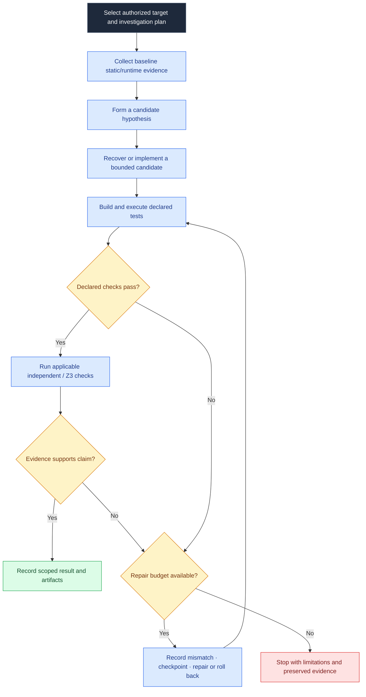

<div align="center">
  
  <h1>RE-Agent</h1>
  <p><strong>Reverse Engineering Agent</strong></p>
  <p>Investigate, maintain, and verify software that no longer has dependable support.</p>
</div>

RE-Agent is a local-first toolkit for **authorized maintenance, compatibility repair, and independent porting of discontinued software and games**. A connected coding agent combines focused skills with RE-Agent’s existing static/runtime analysis, evidence, checkpoints, and bounded build/test/repair workflows. Maintainers can add modular skills without creating a separate platform.

The repository is [heaven-hm/re-agent](https://github.com/heaven-hm/re-agent), renamed from `rea-engine`. The source package identity is `re-agent`; a renamed npm release is not yet published. Existing `rea`, `rea-engine`, `rea-extended`, and `rea-agents` commands and MCP configuration remain available for compatibility.

## Legacy maintenance and modular skills

- Discover built-in and local community skills: `node scripts/rea.mjs maintenance-skills`.
- Bind a supported-scope target and prepare a hosted workflow: `node scripts/rea.mjs maintenance-plan request.json`.
- Execute a caller-supplied bounded comparison/repair plan: `node scripts/rea.mjs maintenance-run request.json controller-plan.json checkpoint.json` (supports `--resume`).
- Scan captured memory bytes without attaching or writing: `node scripts/rea.mjs memory-snapshot-pattern snapshot.bin "48 8B ?? 90"`.
- The host coding agent follows selected skills to reproduce issues, collect static/runtime evidence, repair an isolated replica, build, compare and retain regressions using existing tools. A prepared plan is not a completed scan or repair; arbitrary closed-source reconstruction is not guaranteed.

See [workflow and verification](docs/legacy-maintenance.md), [community skill format](docs/community-skills.md), [audited cheat-agent integration](docs/cheat-agent-integration.md) and [supported-use policy](USAGE_POLICY.md). Six bundled modules cover triage, static diagnosis, runtime/memory observation, repair/port, verification and release review. Discovery never executes community code. See the [macOS validation record and reproduction command](docs/re-agent-maintenance-validation.md).

### 🧭 What RE-Agent is for

RE-Agent is a **reverse engineering agent for maintaining software and games**. A connected coding agent uses its CLI/MCP operations and selected skills to investigate an authorized target, preserve evidence, and implement or verify a scoped change. It is useful for:

- Finding reproducible bugs in discontinued desktop software and games.
- Diagnosing compatibility failures, crashes, missing dependencies, file-format problems, and operating-system assumptions.
- Recovering behavior needed to keep an unsupported application working or to build an independent port.
- Examining suspicious binaries defensively in an isolated, authorized environment, documenting observed behavior, and recommending remediation or removal.
- Verifying repairs with regression tests and explicit evidence, while keeping unknown behavior marked as unknown.

For defensive malware analysis, use an isolated lab and focus on identification, behavior documentation, and protecting or repairing the affected software. RE-Agent does not provide malware deployment, persistence, credential theft, evasion, exploitation, cheat/trainer creation, or unauthorized process modification. See the [supported-use policy](USAGE_POLICY.md).

### 🧩 Recommended skills

The six bundled maintenance modules are the default skill set. A coding agent should select only the modules needed for the investigation; each module supplies focused instructions and required RE-Agent operations.

| Skill                                                                            | Use it to                                                                                                                           |
| -------------------------------------------------------------------------------- | ----------------------------------------------------------------------------------------------------------------------------------- |
| [legacy-triage](maintenance-skills/legacy-triage/SKILL.md)                       | Bind an authorized target, record its hash and support status, reproduce the reported issue, and create an evidence-backed backlog. |
| [legacy-static-diagnosis](maintenance-skills/legacy-static-diagnosis/SKILL.md)   | Inspect functions, callers, imports, strings, data structures, and platform assumptions in the selected static-analysis provider.   |
| [legacy-runtime-memory](maintenance-skills/legacy-runtime-memory/SKILL.md)       | Capture authorized process behavior and inspect caller-provided memory snapshots without modifying the original binary.             |
| [legacy-repair-port](maintenance-skills/legacy-repair-port/SKILL.md)             | Make a scoped repair or independent port in a separate workspace, with evidence linked to the change.                               |
| [legacy-port-verification](maintenance-skills/legacy-port-verification/SKILL.md) | Compare original and candidate behavior, preserve mismatches as regressions, and state the exact test scope.                        |
| [legacy-release-review](maintenance-skills/legacy-release-review/SKILL.md)       | Review evidence, known limitations, licensing, packaging, and whether release claims match the results.                             |

The host agent may also route to installed specialist skills such as Ghidra or radare2 analysis, binary diffing, code audit, supply-chain review, and defensive malware analysis. Those are **optional host-agent skills**, not additional RE-Agent bundled modules; their availability and tools must be checked in the connected agent before use. Community modules can be added in the documented format, but discovery does not execute them.

```mermaid
flowchart LR
    TARGET["Authorized legacy app or game<br/>or isolated suspicious binary"] --> SCOPE["Target identity · permission ·<br/>support status · task limits"]
    SCOPE --> SKILLS["Selected maintenance skills<br/>triage · static · runtime/memory<br/>repair · verification · release"]
    SKILLS --> TOOLS["Existing RE-Agent / REA tools<br/>static analysis · runtime evidence<br/>memory snapshots · comparison"]
    TOOLS --> EVIDENCE["Evidence-backed findings<br/>functions · traces · failures<br/>mismatches · uncertainty"]
    EVIDENCE --> AGENT["Host coding agent<br/>investigate · repair · port"]
    AGENT --> BUILD["Isolated candidate<br/>build · execute · regressions"]
    BUILD --> VERIFY["Scoped verification<br/>results · limits · release review"]
    VERIFY -->|"new mismatch"| EVIDENCE
    VERIFY -->|"documented outcome"| REPORT["Report and preserved evidence"]

    classDef target fill:#fff7ed,stroke:#c2410c,color:#7c2d12
    classDef gate fill:#fef3c7,stroke:#b45309,color:#78350f
    classDef work fill:#eff6ff,stroke:#2563eb,color:#1e3a8a
    classDef proof fill:#ecfdf5,stroke:#059669,color:#064e3b
    class TARGET target
    class SCOPE gate
    class SKILLS,TOOLS,AGENT,BUILD work
    class EVIDENCE,VERIFY,REPORT proof
```



## Verification claims and licensing

Byte-identical artifacts require exact byte comparisons. A native port across OS/CPU architectures normally has different executable bytes; matching a declared finite suite establishes that suite's observations only. Missing evidence stays unverified. Existing benchmark sections below retain their original limited scope and do not prove universal application/game equivalence.

RE-Agent's code remains [MIT](LICENSE), with upstream REA attribution and selected cheat-agent MIT notices preserved. The project supports beneficial, authorized legacy maintenance, not cheats, sabotage or unauthorized changes. The use policy does not rewrite the MIT license. Original applications/assets and optional third-party tools retain their own licenses and redistribution requirements.

## Architecture at a glance

RE-Agent extends the existing [REA](https://github.com/morluto/rea) analysis ecosystem with a bounded investigation and reconstruction layer. The diagrams below distinguish inherited providers from engine-specific orchestration. They describe supported workflows, **not** a promise of fully automatic reconstruction for arbitrary binaries.


### Bounded investigation and repair workflow

Each iteration works from collected evidence and explicit constraints. Verification is conditional and target-dependent; an unsupported recovery or exhausted budget produces a recorded result rather than an equivalence claim.



### Extension boundary and provenance


For implementation details, see the [investigation controller](src/application/autonomy/AutonomousInvestigation.ts), [autonomous discovery](src/composition/autonomousDiscovery.ts), [Frida correlation adapter](src/native/FridaAutonomyTrace.ts), [affine recovery](src/application/autonomy/AffineRecovery.ts), [conditional proof implementation](src/application/autonomy/AffineEquivalenceProof.ts), and [dependency packaging limits](docs/autonomy-tool-bootstrap.md).

### What differs from upstream REA

| Area                           | Reverse Engineering Agent addition                                                                                            | Source / reproducible evidence                                                                                                                          |
| ------------------------------ | ----------------------------------------------------------------------------------------------------------------------------- | ------------------------------------------------------------------------------------------------------------------------------------------------------- |
| Autonomous reconstruction      | Persistent checkpoints, bounded build/test/repair, rollback, mismatch regression inputs                                       | [Controller](src/application/autonomy/AutonomousInvestigation.ts), [25/25 fixture report](docs/verification/rea-extended/fixture-report.json)           |
| Unknown function investigation | Existing static providers feed runtime hypotheses and independent bounded affine reconstruction                               | [Discovery](src/composition/autonomousDiscovery.ts), [recovery](src/application/autonomy/AffineRecovery.ts)                                             |
| Runtime/static correlation     | Owned Frida Gadget profile checks binary identity, ASLR and instruction prefix, records arguments/returns and cleanup         | [Adapter](src/native/FridaAutonomyTrace.ts), [five-call report](docs/verification/rea-extended/frida-report.json)                                       |
| Conditional verification       | Z3 checks extracted scalar expressions under explicit assumptions                                                             | [Proof implementation](src/application/autonomy/AffineEquivalenceProof.ts), [verification guide](docs/autonomous-reconstruction-benchmark.md)           |
| Tool installation and bundles  | Reuse installed tools; pinned official downloads, hashes, health checks, offline wheel/source bundle builder                  | [Bootstrap and license limits](docs/autonomy-tool-bootstrap.md)                                                                                         |
| Coding-agent integration       | Existing CLI/MCP plus autonomous investigation operations and packaged skill instructions; host Codex/Claude can operate them | [Agent workflow](.agents/skills/reverse-engineer-anything/references/autonomous-reconstruction.md), [workflow guide](docs/autonomous-reconstruction.md) |
| Interface                      | Local evidence/status dashboard with pause/resume/stop                                                                        | [Dashboard](src/composition/autonomyDashboard.ts)                                                                                                       |

These are additions to the upstream tool ecosystem. Ghidra, native UI, browser analysis and general Frida capabilities already exist upstream and are not claimed as inventions of this fork.

### Software and game: exact measured comparisons

| Target                                                                             | Result                                                                                                     | Proof                                                                                                                                                                                                                                                                                     |
| ---------------------------------------------------------------------------------- | ---------------------------------------------------------------------------------------------------------- | ----------------------------------------------------------------------------------------------------------------------------------------------------------------------------------------------------------------------------------------------------------------------------------------- |
| LTRData Luhn utility, reconstructed from its published .NET binary                 | **5/5 suites: identical terminal bytes**, 230 numeric/Unicode lines plus mode, usage and termination cases | [Report](docs/verification/rea-engine/luhn-report.json), [complete execution evidence](docs/verification/rea-engine/software-execution-evidence.zip), [reconstructed executable](benchmarks/luhn/replica/Replica.dll)                                                                     |
| Published TicTacToe-AI Windows managed game, rebuilt from recovered code/resources | **19,683/19,683 board configurations: identical observed state bytes; 6/6 frames: identical PNG bytes**    | [Report](docs/verification/rea-engine/game-report.json), [complete execution evidence](docs/verification/rea-engine/game-execution-evidence.zip), [original executable](benchmarks/tictactoe/original/TicTacToe.exe), [rebuilt executable and source](benchmarks/tictactoe/reconstructed) |
| Native branch validation fixture                                                   | 25/25 declared cases after repair                                                                          | [Report](docs/verification/rea-extended/fixture-report.json)                                                                                                                                                                                                                              |
| Installed Apple Calculator                                                         | 10/10 final numeric-display comparisons in the recorded smaller suite                                      | [Report](docs/verification/rea-extended/calculator-report.json); complete UI and expanded suite remain unverified                                                                                                                                                                         |

**These results prove exact equality of the listed captured bytes, not byte-identical executable files or universal equivalence.** Every original/replica executable hash differs. The game comparison exhausts the defined board input space for its win/draw function; AI, RNG, all menus, timing and whole-game behavior remain unverified. The Windows managed artifacts ran on macOS .NET/Mono; this is not proof of native Windows OS execution or native AppKit port fidelity.

The analysis used REA's `inspect-managed-members`, `import-managed-reconstruction` and `capture-process` workflows, with ILSpy recovery and real compilation. The host coding agent operated the engine; no model API key was required. Game source was recovered from the binary, not consulted from the original repository. A pinned original source archive was subsequently retained solely for GPL redistribution obligations. The independent software implementation preserves a recovered quirk: checksum parity counts UTF-16 string length, including punctuation.

#### Software capture proof viewer

This is an actual screenshot of the engine's proof viewer, captured through REA's owned browser scenario after recomputing the supplied terminal-file hashes. It shows recorded original/replica CLI output; it is not an original-app GUI screenshot. [Browser evidence and verified cleanup](docs/verification/rea-engine/proof-browser-evidence.json).


#### Actual original and rebuilt game renders

These are actual `Form.DrawToBitmap` renders after the same button-handler sequence on the same Mono/X11 runtime. They are not Windows desktop screenshots. Their PNG SHA-256 is identical: `67673e4f3536084732a35c6da809ea5a69ea89afb0f336c3870a9b0baaa855be`.

| Original compiled game                                                          | Rebuilt game                                                                  |
| ------------------------------------------------------------------------------- | ----------------------------------------------------------------------------- |
|  |  |

[Interactive proof report](docs/verification/rea-engine/index.html) · [Reproduction and scope](benchmarks/README.md) · [artifact SHA-256 inventory](docs/verification/rea-engine/manifest.json)

### Installed tools versus distributed tools

Development health checks confirmed Frida 17.23.3, LIEF 1.0.0, Z3 5.1.0.0, Capstone 5.0.9 and Pillow 12.3.0. Ghidra/radare2 and native compilers are reused locally. **Bundled now:** the signature-verified ILSpy package and the built X11 libgdiplus library with source and licenses. The [preview release](https://github.com/heaven-hm/re-agent/releases/tag/engine-preview-2026-10-13) also carries the checksum-verified, unmodified Ghidra 12.1.2 archive; see its [manifest](third_party/ghidra/manifest.json). **A clone does not contain every installed external tool binary.** The installer and offline bundle builder are shipped in source; generated local bundles are not a license-approved public distribution. Frida/LIEF native dependency source and license coverage require further audit. Optional licensed tools and Apple Calculator are not redistributed. See [tool profiles and limitations](docs/autonomy-tool-bootstrap.md).

# Native Windows → macOS ports (Batch 1)

Independent macOS reconstructions and one explicitly blocked investigation of
six MIT-licensed native Windows targets, recovered binary-first with REA (no
original source consulted). Five Windows originals and the available macOS
replicas are committed under
`benchmarks/native-windows-ports/` with manifests, goldens and reports.

| Target                | Original (Windows x64)                                           | macOS port                                     | Status                             |
| --------------------- | ---------------------------------------------------------------- | ---------------------------------------------- | ---------------------------------- |
| Snake v1.1.0          | `original-binaries/snake-windows-x86_64.exe` (55KB)              | `snake/replica/snakemac` (C, terminal)         | Structural frame parity            |
| PixelTetris v1.0.0    | `original-binaries/Pixeltetris.exe` (1.1MB, SDL2)                | `pixeltetris/replica/pixelmac` (C, SDL2)       | Menu+gameplay; shots pending       |
| Tetris v1.0.0         | `original-binaries/Tetris.exe` (2.2MB, SDL2)                     | `tetris/replica/tetrismac` (C, SDL2)           | Menu screenshot verified           |
| legacy-notepad v1.2.1 | `original-binaries/legacy-notepad-x64.exe` (263KB, Win32)        | `notepad/replica/notepadmac` (Swift, AppKit)   | Unicode window verified            |
| Clipjar v1.2.0        | `original-binaries/clipjar.exe` (5.3MB, Rust)                    | `clipjar/replica/clipjarmac` (Swift, menu-bar) | SQLite capture/persist/dedupe PASS |
| imgview v0.3          | `original-binaries/imgview64.exe` (UPX stub, unpacked upx 5.2.1) | `imgview/replica/imgviewmac` (Swift, AppKit)   | PNG render verified                |

## Port evidence

Tetris macOS port, live menu + gameplay windows:


Notepad macOS port, live Unicode window:


PixelTetris macOS port, live menu + gameplay windows:


Snake: 26-line terminal frames byte-identical modulo RNG cells
(`snake/original-run0.txt`); Clipjar: synthetic capture → SHA-256 row,
restart persistence and hash-dedupe verified against live SQLite.

See `benchmarks/native-windows-ports/reports/` (license audit, binary
analysis, functional results, limitations). Whole-executable identity is
not claimed; unverified items are listed per target, not hidden.

## Native Binary Reconstruction — Benchmark Batch 2

The complete app/game inventory across managed examples, Batch 1 and Batch 2 is in the [package-checked benchmark catalog](benchmarks/catalog.json), with per-target implementation and evidence links in the [benchmark index](benchmarks/README.md).

**Current result: incomplete; all six application-level results are UNVERIFIED.**
All six requested official Windows assets were downloaded, publisher SHA-256
verified, and actual native x64 PE executables inventoried. No upstream
implementation source was used. Originals and runtime assets stay private.

| Target                    | Windows release and binary                                                                                                                 | macOS reconstruction                                                                                         | Functional comparison                    |
| ------------------------- | ------------------------------------------------------------------------------------------------------------------------------------------ | ------------------------------------------------------------------------------------------------------------ | ---------------------------------------- |
| OpenLieroX — C++ game     | [20260912.1 ZIP](https://github.com/openlierox/openlierox/releases/download/20260912.1/openlierox-20260912.1-windows.zip)                  | Unimplemented                                                                                                | UNVERIFIED                               |
| SuperTux — C++ game       | [v0.7.0 portable ZIP](https://github.com/SuperTux/supertux/releases/download/v0.7.0/SuperTux-v0.7.0-win64-portable.zip)                    | Unimplemented                                                                                                | UNVERIFIED                               |
| The Powder Toy — C++ game | [v100.1.400 EXE](https://github.com/The-Powder-Toy/The-Powder-Toy/releases/download/v100.1.400/powder-v100.1.400-x86_64-windows-mingw.exe) | Unimplemented                                                                                                | UNVERIFIED                               |
| ripgrep — Rust utility    | [15.2.0 ZIP](https://github.com/BurntSushi/ripgrep/releases/download/15.2.0/ripgrep-15.2.0-x86_64-pc-windows-msvc.zip)                     | Independent C++17 macOS subset; 7/8 retained CrossOver observations match after path-separator normalization | PARTIAL feature / application UNVERIFIED |
| fd — Rust utility         | [v10.5.0 ZIP](https://github.com/sharkdp/fd/releases/download/v10.5.0/fd-v10.5.0-x86_64-pc-windows-msvc.zip)                               | C++ ARM64 candidate; 2 raw, 9 normalized search cases pass                                                   | PARTIAL feature / application UNVERIFIED |
| bat — Rust utility        | [v0.26.1 ZIP](https://github.com/sharkdp/bat/releases/download/v0.26.1/bat-v0.26.1-x86_64-pc-windows-msvc.zip)                             | C++ ARM64 candidate; 8/8 plain-output cases pass                                                             | PARTIAL feature / application UNVERIFIED |

Original executable SHA-256 values, distinct from release archive hashes:

| Target         | Original PE SHA-256                                                |
| -------------- | ------------------------------------------------------------------ |
| OpenLieroX     | `0f79c968ab9aabd8cb99e173500fa241e883846fd3e0c9ca2f7f0bf3771fa5c1` |
| SuperTux       | `6249f25a6ac1cc3d27955ca09852b8368618ce58ad9c13e0c5084051c2c02b43` |
| The Powder Toy | `df32b616b31dabae10b82028731ebdfd6867c872198b81f29d418cbafbf460c3` |
| ripgrep        | `14231169855ec5205cf5a1b6f1db358ff4aed4247c86b69ce8aae647c77f6680` |
| fd             | `d67d27a8e375ed7e9bca2b506a9dd5082bc24547aeba908b863f6f8b8ab0c3b9` |
| bat            | `9ea9f7ab1c27aa5c9390e91543f9f47c6bd17bc53f3e30ac9db762f28f55c4fd` |

**Actual capabilities used:** existing REA MCP/Ghidra workflows and PE resource
Evidence, installed compilers, tool health inventory, owned process supervision,
and the existing autonomous controller's checkpoint creation/reopening. Deep
analysis timed out or was cancelled under host memory/disk pressure. No Batch 2
native function recovery is verified. Original utility probes through CrossOver
timed out; actual Windows OS behavior remains unverified. The controller also
rejected a compatibility launcher that differed from its hash-bound target.

**New extension:** a reusable bounded file differential benchmark runner compares
exact output-file bytes, diagnostics and exit outcomes in independent workdirs.
Its infrastructure tests use actual child processes; they are separate from
application fidelity tests. Windows workers, complete native recovery, FLOSS/capa
integration and game reconstruction remain future work.

Receipt-derived records currently contain **23 completed utility comparisons:
10 raw byte/exit passes, 13 raw differences, and 9 additional fd search cases
that pass only under declared path/order normalization**. fd has 2 raw passes
among 15 cases; bat has 8/8 raw passes for its declared plain-output cases.
These are feature-level results; all six Batch 2 applications remain PARTIAL
or UNVERIFIED overall. fd has a completed bounded repair loop, while gameplay,
game screenshots, original Windows OS execution, whole-application equivalence
and formal proofs remain unavailable. See the
[receipt-derived Batch 2 summary](benchmarks/native-batch-2/README.md) and
[target reports](benchmarks/native-batch-2/reports/).

[Full Batch 2 report](benchmarks/native-batch-2/reports/batch-2-overview.md) ·
[binary/import inventory](benchmarks/native-batch-2/reports/binary-inventory.json) ·
[license audit](benchmarks/native-batch-2/reports/license-audit.md) ·
[native build/execution results](benchmarks/native-batch-2/reports/macos-build-results.md) ·
[functional cases](benchmarks/native-batch-2/reports/functional-tests.json) ·
[measured metrics](benchmarks/native-batch-2/reports/performance-results.json) ·
[visual evidence status](benchmarks/native-batch-2/reports/visual-comparisons.md) ·
[known blockers](benchmarks/native-batch-2/reports/known-limitations.md)

## Build and use this repository

```sh
git clone https://github.com/heaven-hm/re-agent.git
cd re-agent
npm ci
npm run build:cached
node scripts/print-mcp-config.mjs /absolute/path/to/target --local
node scripts/rea.mjs --help
```

Use the printed local MCP configuration with your host coding agent and the built packaged skill. A published upstream npm package is not this fork. The implementation retains compatible command names while the product identity is Reverse Engineering Agent.

## Documentation

- [Autonomous reconstruction and host-agent workflow](docs/autonomous-reconstruction.md)
- [Executed benchmarks and reproduction](docs/autonomous-reconstruction-benchmark.md)
- [Static/runtime tool bootstrap and offline bundles](docs/autonomy-tool-bootstrap.md)
- [CLI and evidence](docs/cli.md)
- [Ghidra provider](docs/ghidra-provider.md)
- [Managed .NET analysis](docs/managed-code-analysis.md)
- [MCP contracts](docs/mcp-contracts.md)
- [Licensing](LICENSE) and [third-party notices](THIRD_PARTY_NOTICES.md)

Report issues and contribute at [heaven-hm/re-agent](https://github.com/heaven-hm/re-agent).

Latest validation: the complete managed benchmark command passed again with verified owned-display cleanup. The focused autonomy regression batch passed 37 tests with 2 skipped; type and lint checks passed. [Execution logs and checksum inventory](docs/verification/rea-engine/manifest.json). These are scoped development checks, not certification of all REA capabilities.
