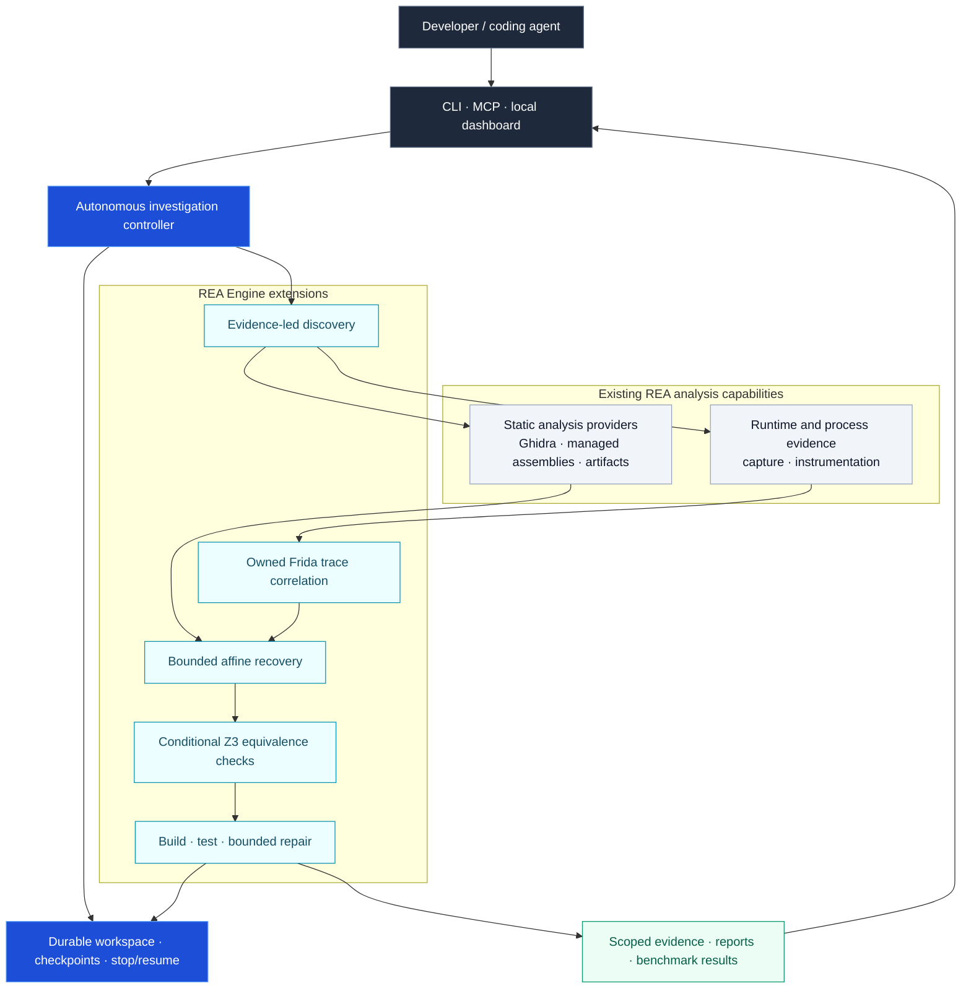
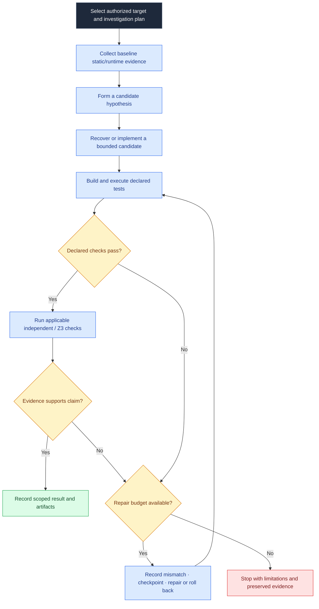
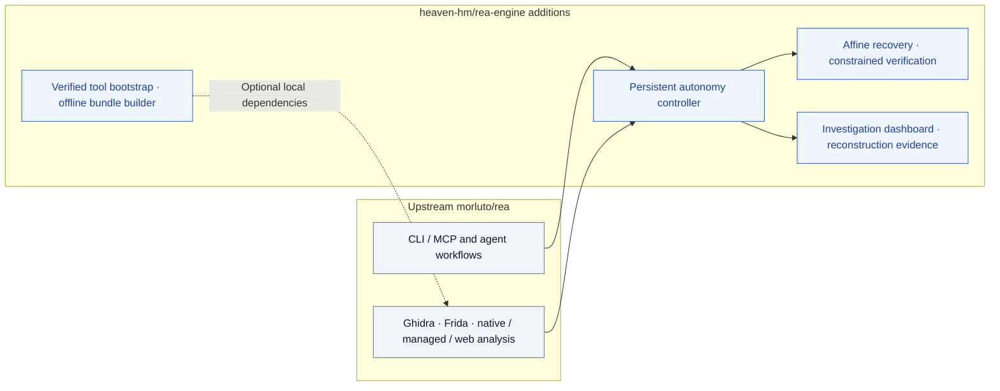

# Reverse Engineering Engine

**Repository: [heaven-hm/rea-engine](https://github.com/heaven-hm/rea-engine).**
Reverse Engineering Engine builds directly on [morluto/rea](https://github.com/morluto/rea), retaining its MIT license, attribution and working integrations. The package identity is `rea-engine`; compatible `rea` and `rea-agents` command aliases are retained. Registry metadata is configured for `io.github.heaven-hm/rea-engine`; this does not imply npm or MCP Registry publication.

## Architecture at a glance

REA Engine extends the existing [REA](https://github.com/morluto/rea) analysis ecosystem with a bounded investigation and reconstruction layer. The diagrams below distinguish inherited providers from engine-specific orchestration. They describe supported workflows, **not** a promise of fully automatic reconstruction for arbitrary binaries.



### Bounded investigation and repair workflow

Each iteration works from collected evidence and explicit constraints. Verification is conditional and target-dependent; an unsupported recovery or exhausted budget produces a recorded result rather than an equivalence claim.



### Extension boundary and provenance



For implementation details, see the [investigation controller](src/application/autonomy/AutonomousInvestigation.ts), [autonomous discovery](src/composition/autonomousDiscovery.ts), [Frida correlation adapter](src/native/FridaAutonomyTrace.ts), [affine recovery](src/application/autonomy/AffineRecovery.ts), [conditional proof implementation](src/application/autonomy/AffineEquivalenceProof.ts), and [dependency packaging limits](docs/autonomy-tool-bootstrap.md).

### What differs from upstream REA

| Area                           | Reverse Engineering Engine addition                                                                                           | Source / reproducible evidence                                                                                                                          |
| ------------------------------ | ----------------------------------------------------------------------------------------------------------------------------- | ------------------------------------------------------------------------------------------------------------------------------------------------------- |
| Autonomous reconstruction      | Persistent checkpoints, bounded build/test/repair, rollback, mismatch regression inputs                                       | [Controller](src/application/autonomy/AutonomousInvestigation.ts), [25/25 fixture report](docs/verification/rea-extended/fixture-report.json)           |
| Unknown function investigation | Existing static providers feed runtime hypotheses and independent bounded affine reconstruction                               | [Discovery](src/composition/autonomousDiscovery.ts), [recovery](src/application/autonomy/AffineRecovery.ts)                                             |
| Runtime/static correlation     | Owned Frida Gadget profile checks binary identity, ASLR and instruction prefix, records arguments/returns and cleanup         | [Adapter](src/native/FridaAutonomyTrace.ts), [five-call report](docs/verification/rea-extended/frida-report.json)                                       |
| Conditional verification       | Z3 checks extracted scalar expressions under explicit assumptions                                                             | [Proof implementation](src/application/autonomy/AffineEquivalenceProof.ts), [verification guide](docs/autonomous-reconstruction-benchmark.md)           |
| Tool installation and bundles  | Reuse installed tools; pinned official downloads, hashes, health checks, offline wheel/source bundle builder                  | [Bootstrap and license limits](docs/autonomy-tool-bootstrap.md)                                                                                         |
| Coding-agent integration       | Existing CLI/MCP plus autonomous investigation operations and packaged skill instructions; host Codex/Claude can operate them | [Agent workflow](.agents/skills/reverse-engineer-anything/references/autonomous-reconstruction.md), [workflow guide](docs/autonomous-reconstruction.md) |
| Interface                      | Local evidence/status dashboard with pause/resume/stop                                                                        | [Dashboard](src/composition/autonomyDashboard.ts)                                                                                                       |

These are additions to the upstream tool ecosystem. Ghidra, native UI, browser analysis and general Frida capabilities already exist upstream and are not claimed as inventions of this fork.

### Software and game: exact measured comparisons

| Target                                                                             | Result                                                                                                     | Proof                                                                                                                                                                                                                                                                                     |
| ---------------------------------------------------------------------------------- | ---------------------------------------------------------------------------------------------------------- | ----------------------------------------------------------------------------------------------------------------------------------------------------------------------------------------------------------------------------------------------------------------------------------------- |
| LTRData Luhn utility, reconstructed from its published .NET binary                 | **5/5 suites: identical terminal bytes**, 230 numeric/Unicode lines plus mode, usage and termination cases | [Report](docs/verification/rea-engine/luhn-report.json), [complete execution evidence](docs/verification/rea-engine/software-execution-evidence.zip), [reconstructed executable](benchmarks/luhn/replica/Replica.dll)                                                                     |
| Published TicTacToe-AI Windows managed game, rebuilt from recovered code/resources | **19,683/19,683 board configurations: identical observed state bytes; 6/6 frames: identical PNG bytes**    | [Report](docs/verification/rea-engine/game-report.json), [complete execution evidence](docs/verification/rea-engine/game-execution-evidence.zip), [original executable](benchmarks/tictactoe/original/TicTacToe.exe), [rebuilt executable and source](benchmarks/tictactoe/reconstructed) |
| Native branch validation fixture                                                   | 25/25 declared cases after repair                                                                          | [Report](docs/verification/rea-extended/fixture-report.json)                                                                                                                                                                                                                              |
| Installed Apple Calculator                                                         | 10/10 final numeric-display comparisons in the recorded smaller suite                                      | [Report](docs/verification/rea-extended/calculator-report.json); complete UI and expanded suite remain unverified                                                                                                                                                                         |

**These results prove exact equality of the listed captured bytes, not byte-identical executable files or universal equivalence.** Every original/replica executable hash differs. The game comparison exhausts the defined board input space for its win/draw function; AI, RNG, all menus, timing and whole-game behavior remain unverified. The Windows managed artifacts ran on macOS .NET/Mono; this is not proof of native Windows OS execution or native AppKit port fidelity.

The analysis used REA's `inspect-managed-members`, `import-managed-reconstruction` and `capture-process` workflows, with ILSpy recovery and real compilation. The host coding agent operated the engine; no model API key was required. Game source was recovered from the binary, not consulted from the original repository. A pinned original source archive was subsequently retained solely for GPL redistribution obligations. The independent software implementation preserves a recovered quirk: checksum parity counts UTF-16 string length, including punctuation.

#### Software capture proof viewer

This is an actual screenshot of the engine's proof viewer, captured through REA's owned browser scenario after recomputing the supplied terminal-file hashes. It shows recorded original/replica CLI output; it is not an original-app GUI screenshot. [Browser evidence and verified cleanup](docs/verification/rea-engine/proof-browser-evidence.json).


#### Actual original and rebuilt game renders

These are actual `Form.DrawToBitmap` renders after the same button-handler sequence on the same Mono/X11 runtime. They are not Windows desktop screenshots. Their PNG SHA-256 is identical: `67673e4f3536084732a35c6da809ea5a69ea89afb0f336c3870a9b0baaa855be`.

| Original compiled game                                                          | Rebuilt game                                                                  |
| ------------------------------------------------------------------------------- | ----------------------------------------------------------------------------- |
|  |  |

[Interactive proof report](docs/verification/rea-engine/index.html) · [Reproduction and scope](benchmarks/README.md) · [artifact SHA-256 inventory](docs/verification/rea-engine/manifest.json)

### Installed tools versus distributed tools

Development health checks confirmed Frida 17.23.3, LIEF 1.0.0, Z3 5.1.0.0, Capstone 5.0.9 and Pillow 12.3.0. Ghidra/radare2 and native compilers are reused locally. **Bundled now:** the signature-verified ILSpy package and the built X11 libgdiplus library with source and licenses. The [preview release](https://github.com/heaven-hm/rea-engine/releases/tag/engine-preview-2026-10-13) also carries the checksum-verified, unmodified Ghidra 12.1.2 archive; see its [manifest](third_party/ghidra/manifest.json). **A clone does not contain every installed external tool binary.** The installer and offline bundle builder are shipped in source; generated local bundles are not a license-approved public distribution. Frida/LIEF native dependency source and license coverage require further audit. Optional licensed tools and Apple Calculator are not redistributed. See [tool profiles and limitations](docs/autonomy-tool-bootstrap.md).

## Build and use this repository

```sh
git clone https://github.com/heaven-hm/rea-engine.git
cd rea-engine
npm ci
npm run build:cached
node scripts/print-mcp-config.mjs /absolute/path/to/target --local
node scripts/rea.mjs --help
```

Use the printed local MCP configuration with your host coding agent and the built packaged skill. A published upstream npm package is not this fork. The implementation retains compatible command names while the product identity is Reverse Engineering Engine.

## Documentation

- [Autonomous reconstruction and host-agent workflow](docs/autonomous-reconstruction.md)
- [Executed benchmarks and reproduction](docs/autonomous-reconstruction-benchmark.md)
- [Static/runtime tool bootstrap and offline bundles](docs/autonomy-tool-bootstrap.md)
- [CLI and evidence](docs/cli.md)
- [Ghidra provider](docs/ghidra-provider.md)
- [Managed .NET analysis](docs/managed-code-analysis.md)
- [MCP contracts](docs/mcp-contracts.md)
- [Licensing](LICENSE) and [third-party notices](THIRD_PARTY_NOTICES.md)

Report issues and contribute at [heaven-hm/rea-engine](https://github.com/heaven-hm/rea-engine).

Latest validation: the complete managed benchmark command passed again with verified owned-display cleanup. The focused autonomy regression batch passed 37 tests with 2 skipped; type and lint checks passed. [Execution logs and checksum inventory](docs/verification/rea-engine/manifest.json). These are scoped development checks, not certification of all REA capabilities.
